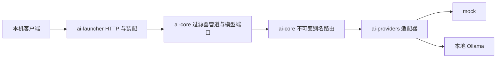

# 架构与 AGW 借鉴

## 系统定位

以 Java AI Gateway + 模型路由平台为工程主线，用 Archiver Incident Copilot 串联未来 RAG 和工具执行。当前实现同步网关、启动配置的精确别名路由及基础计量。业务编排通过模型端口调用适配器，HTTP、厂商协议和框架留在边界。

图示展示当前运行时边界；依赖方向与 Gradle 模块见[模块清单](runtime-modules.md)。验证入口：`AiApplication` 的显式 Bean 装配和 `ChatHttpTest` / `ProviderFailureHttpTest`。

## 借鉴来源与迁移

来源是本机 `/Users/Winston.Xie/Projects/platform/agw/docs/architecture`；阅读时 AGW HEAD 为 `d7af5299e`。本项目没有复制 AGW / garm 源码、私有包、配置或凭据，也不依赖该仓库构建。

| AGW / garm 思想 | 本项目选择 | 当前状态与验证 |
|---|---|---|
| garm 框架 / AGW 平台策略 / launcher 分离 | 无框架 core、厂商 adapter、显式装配 | 已实现；模块 `build.gradle` 与 core 编译依赖检查 |
| 端点 + 过滤器 + 处理器 | 不可变过滤器列表 + around 调用 + provider terminal | 已实现；`PipelineTest` 检查顺序、异常清理、短路 |
| 统一身份、路由、错误、统计 | 服务端 requestId，多别名精确路由，统一错误，按路由计时/usage 和聚合 HTTP 指标 | 已实现；HTTP 测试；身份认证待实现 |
| 配置驱动的动态路由 | 已支持启动时不可变路由表；热更新和原子切换留待 M3 | 启动路由见 `ModelRouterTest` / `RoutingHttpTest`；动态更新 Verification: Missing |
| 重试、熔断、故障转移 | AI 调用有费用、输出与副作用；M0 不自动重试 | 适配器单次调用；`OllamaChatModelTest`；M3 增加故障实验 |
| Netty 流式代理与背压 | M0 同步 MVC；M2 用 SSE / Reactor 学取消、背压和长连接 | 待实现；Verification: Missing，M2 验收补齐 |
| 失败也能清理资源 | around `try/finally` 只对已进入的过滤器退栈 | 已实现；`PipelineTest` |
| 可观测性、日志脱敏 | 不记录 prompt、回答、请求体或异常正文，只记请求 ID、结果与耗时 | `ObservationFilter` 和异常映射代码；敏感数据自动扫描待补 |

与 AGW 不同：这里需要解析模型输入输出、区分模型与工具权限、跟踪 token 与质量。后续 RAG 和工具编排放在应用层，不能塞进传输层代理过滤器。

## 边界与失败原则

- 模型输出 MUST 作为不可信数据；未来工具调用需要独立授权，模型说“允许”不构成权限。
- 逻辑别名 MUST 由服务端映射；未知别名返回 404，客户端不能选择上游地址。验证：`ChatHttpTest` / `ProviderFailureHttpTest`。
- M0 没有鉴权；回环绑定是本地学习范围，不等同于完整安全方案。Verification：检查 `application.properties`，M3 增加鉴权测试。
- provider 超时和错误映射为受控 502；不得向客户端返回原始上游错误。验证：适配器契约与 `ChatHttpTest` / `ProviderFailureHttpTest`。
- mock 的 usage MUST 标记 unavailable，不能把字符数伪装成模型 token。验证：`ChatHttpTest` / `ProviderFailureHttpTest`。
- 流式响应开始后不允许静默切换模型或重放输出；未来写工具不得无条件重试。Verification: Missing，分别在 M2 / M6 实验中实现。

## 未来边界

M4–M5 增加 retrieval / ingestion；M6 增加工具注册、执行记录与审批；M7 增加 MCP adapter；M8 增加持久化工作流。先在单体中形成清晰模块边界，有证据再拆服务。Python 评测通过版本化 JSONL / HTTP 交互，不通过进程内耦合。

## Verification

构建与测试见[测试策略](../testing/strategy.md)。AGW 依据：`technical-architecture.md` §3、§4.3、§4.5、§5.1，以及 `garm-netty.md` §3–§5；这些来源提供借鉴依据，不代表本项目已实现其全部能力。
