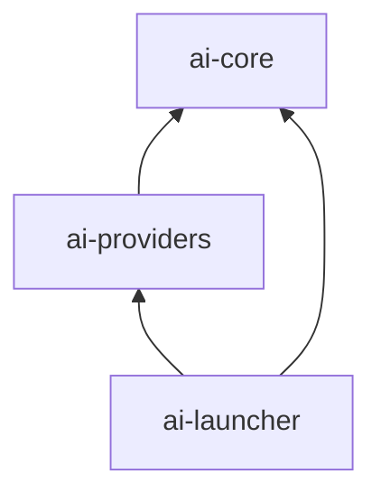

# 运行时模块与依赖方向

| 模块 | 负责 | 同级依赖与原因 | 不负责 |
|---|---|---|---|
| ai-core | 消息与模型端口、请求上下文、管道语义、不可变精确别名路由 | None | Spring、HTTP、厂商 JSON、数据库 |
| ai-providers | mock 与 Ollama 协议适配和错误归一化 | ai-core：实现模型端口 | 对外路由与应用业务编排 |
| ai-launcher | 启动、HTTP DTO 校验、路由配置绑定与模型目录、显式装配、错误映射、基础观测、静态 Admin Portal | ai-core：调用领域端口；ai-providers：装配实现 | 训练模型、知识库与工具执行 |

`AiApplication` 是唯一 composition root。入口 `ChatController` 将 Web DTO 转成领域请求，`ObservationFilter` 环绕请求执行，terminal 是实现 `ChatModel` 的 `ModelRouter`，再按别名选择一个 adapter。`ModelController` 只读同一个路由表提供目录；`ObservationFilter` 用该表约束指标标签并记录调用和供应商 usage。过滤器顺序由显式列表决定，无反射扫描优先级规则。新增过滤器需要解释顺序和清理行为。

实线为编译依赖；core 不得反向引用 provider 或 launcher。当前 Gradle 模块边界防止反向依赖形成环，但没有额外的包级架构测试。

## Verification

根与各模块的 `build.gradle`；`PipelineTest`；`ModelRouterTest`；`RoutingHttpTest`；`ChatHttpTest`。`./gradlew :ai-core:dependencies --configuration compileClasspath` 检查 core 没有 Spring 和 HTTP 客户端依赖。
