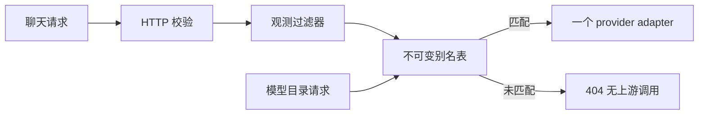

# 模型别名路由与调用计量

## 目标与范围

把单个启动 provider 扩展为一组服务端配置的模型别名，让同一网关能承载 mock 和多个 Ollama 模型。这里的“规则”是精确别名匹配；尚不包含按语义、任务、成本、延迟或质量自动选型。它是 [AI Platform 学习路线](../../learning/roadmap.md) 的基础增量，不能代表完整 M3 已完成。

## 行为与边界

- `POST /api/chat` 契约保持不变，`model` 选择已配置别名；响应保留逻辑别名，并由 adapter 返回实际 provider 与 upstreamModel。未知别名返回 404，且 MUST NOT 调用上游。
- `GET /api/models` 返回已装配别名、provider 和 simulated 标记。目录不触发推理，不返回上游 URL，不表示模型已经安装、可用或健康。DTO 见 [ModelRouter.Descriptor](../../../ai-core/src/main/java/dev/learning/ai/core/ModelRouter.java)。
- 同一次请求只命中一个路由、只调用一次 provider。异常保持受控 502，不自动改用 mock 或其他模型；静默降级会混淆质量与成功率。
- 启动时验证配置并建立不可变路由表。别名唯一，使用字母/数字开头及字母、数字、点、下划线、连字符，长度不超过请求契约上限。重复/非法别名、未知 provider、无效 Ollama 参数 MUST 阻止启动。
- 路由依据仅来自本机启动配置。此阶段没有身份认证、租户隔离、在线配置、限流或计费；不得把别名 allowlist 解释为授权系统。

图中目录只读取描述信息；调用走既有过滤器链。验证：`ModelRouterTest`、`RoutingHttpTest`。

## 配置与兼容

配置结构由 [RoutingProperties](../../../ai-launcher/src/main/java/dev/learning/ai/launcher/RoutingProperties.java) 定义；可复制示例见根目录 [application.properties.example](../../../application.properties.example)。

未配置 `ai.routing.routes` 时，保留 `assistant → ai.provider`，继续支持原来的 `AI_PROVIDER` 与 `OLLAMA_*`。配置非空路由列表时，它完整替换隐式路由；需要 `assistant` 时必须显式列出。Ollama 路由可覆盖 model、base-url、timeout-seconds，未指定项继承 `ai.ollama.*`；provider 和 alias 必须逐项指定。

列表从索引 0 连续填写，放在同一配置来源中。Spring 的列表覆盖不是逐项合并；不要只通过另一个配置来源覆盖某个索引。修改后重启，无热更新。

回滚：移除整个 `ai.routing.routes` 列表并设置 `AI_PROVIDER=mock` 后重启；只设置 `AI_PROVIDER=mock` 不会覆盖显式路由列表。无需迁移数据。

## 观测与解释限制

`ai.gateway.calls` 是 Micrometer Timer：按已配置的 `model`、`provider`、`outcome` 分组记录次数与总耗时，包括成功、上游失败和未知模型拒绝。任意未知别名统一归为 `_unknown`，防止客户端输入造成无限标签；requestId 与消息内容不作为标签。HTTP 参数校验失败发生在管道前，由现有 HTTP 指标覆盖。

`ai.gateway.tokens` 按路由和 input/output 累计非模拟结果中供应商报告的非负 token 数。缺失 usage 不补零、不按字符推算；失败请求可能已经产生上游消耗，但本指标无法得知。该计数不是账单，也不包含价格、预算预留、退款或持久化。进程重启会重置累计量。

通过 `/actuator/metrics/ai.gateway.calls` 与 `/actuator/metrics/ai.gateway.tokens` 查看；未发生对应事件时指标可能尚不存在。尚未配置 P95 直方图、TTFT、Prometheus exporter、OTel 或告警。

## Verification

- `ModelRouterTest`：正确目标、只调用一次、未知别名不出站、无隐式 fallback、重复规则拒绝、快照不可变。
- `RoutingConfigurationTest`：装配时拒绝无效配置。
- `RoutingHttpTest`：同一实例路由到 mock 与本地 Ollama HTTP stub；校验上游模型名、usage、目录无副作用和显式配置替换规则。
- `ObservationFilterTest`：成功/错误/拒绝指标，未知别名标签有界，缺失/模拟/估算 usage 不计为真实用量。
- `ChatHttpTest` / `ProviderFailureHttpTest`：原来的默认模式、HTTP 错误及 Portal 资源回归。
- 执行 `./gradlew build`；真实多模型质量、延迟与成本比较仍为 Verification: Missing。
